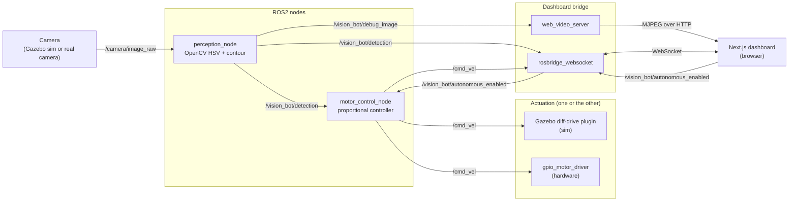
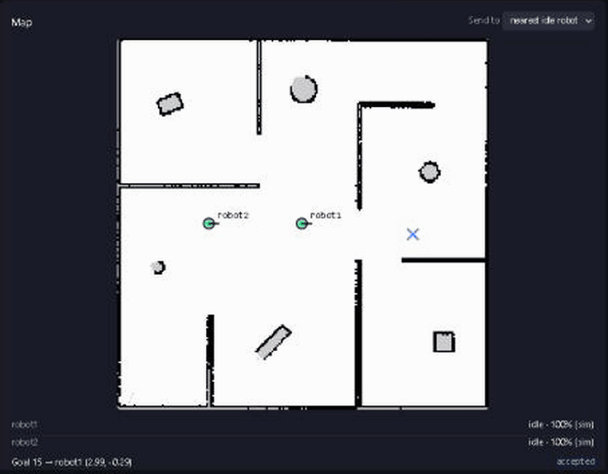

# vision_bot -- Vision-Guided Rover

[](https://github.com/ZacheryByrd/vision-bot-project/actions/workflows/ci.yml)
[](https://github.com/ZacheryByrd/vision-bot-project/actions/workflows/v2-ci.yml)

**v2** (autonomous navigation and a two-robot fleet) is described in
[v2: autonomous navigation and a two-robot fleet](#v2-autonomous-navigation-and-a-two-robot-fleet)
below. For v1, read **`PROJECT_PLAN.md`** first -- it has the full architecture rationale,
week-by-week roadmap, hardware parts list (optional), and resume framing.

This repo is a real, runnable project, not pseudocode:

```
ros2_ws/src/vision_bot/   ROS2 package: perception_node, motor_control_node,
                           gpio_motor_driver, Gazebo launch + world + URDF
docker/                    Dockerfile + compose file -- the actual dev
                           environment (ROS2 Humble + Gazebo Classic 11)
dashboard/                 Next.js live-feed + status dashboard
PROJECT_PLAN.md            Full plan: roadmap, architecture, parts list
```

## Architecture

Perception and control are independent ROS2 nodes that only ever talk to
each other over topics -- that separation is the whole point (see
`PROJECT_PLAN.md` section 1). Nothing about vision lives in the control
node; nothing about motors lives in the perception node. The dashboard is
a third, completely separate consumer of the same topics via rosbridge --
it can't see anything the ROS2 graph doesn't already expose.



## Quickstart (simulation)

Windows has no good native ROS2 install path, so development happens inside
a Docker container. You'll want two terminals open once it's running: one
for the sim itself, one for driving it / inspecting topics.

**One-time setup (Windows only, for the Gazebo GUI window):**

```powershell
winget install marha.VcXsrv
Start-Process "C:\Program Files\VcXsrv\vcxsrv.exe" -ArgumentList "-multiwindow","-clipboard","-wgl","-ac"
```

`-ac` disables X11 access control so the container can connect to it. If a
Windows Firewall prompt appears the first time, click Allow. VcXsrv needs to
be running (check your system tray) before you launch the sim; it doesn't
survive a reboot on its own, so re-run the `Start-Process` line if it's gone.

**Terminal 1 -- build and launch:**

```powershell
cd docker
docker compose run --rm ros
```

This drops you into the container's bash shell (`root@<id>:/workspace/ros2_ws#`).
From there:

```bash
colcon build --symlink-install
source install/setup.bash
ros2 launch vision_bot sim_launch.py
```

A Gazebo window should appear (rendered via VcXsrv) with the rover and a red
target box. Pass `gui:=false` to run headless instead (e.g. in CI).

For the line-following demo instead -- the rover continuously follows a
yellow octagon track rather than approaching and stopping at a static
target -- launch `line_follow_launch.py` instead of `sim_launch.py`. Same
nodes, same topics, just a different world + HSV threshold + control gains
(passed as launch arguments; see that file's docstring for what changed and
why). No other steps differ.

For a demo using a real trained model instead of color thresholding --
detecting an actual "person" class via a pretrained MobileNet-SSD (OpenCV's
`cv2.dnn`) rather than a hand-picked HSV range -- launch `dnn_follow_launch.py`.
Same approach-and-stop behavior as the red-box demo, same nodes, same
topics; only `perception_node`'s `detector_backend` parameter changes. See
that file's docstring for why the target is a real photo of a person
textured onto a flat plane rather than a 3D humanoid model -- the obvious
approach (primitives: box torso, sphere head) gets exactly 0.0 confidence
from a real-world-trained detector.

**Terminal 2 -- drive it manually / inspect topics:**

```powershell
cd docker
docker compose exec ros bash
```

```bash
source /opt/ros/humble/setup.bash
ros2 topic list
ros2 run teleop_twist_keyboard teleop_twist_keyboard
```

Or check the perception pipeline directly:

```bash
ros2 topic echo /vision_bot/detection
ros2 run rqt_image_view rqt_image_view   # view /vision_bot/debug_image
```

`motor_control_node` and `teleop_twist_keyboard` both publish to `/cmd_vel`
with no arbitration, so manual driving fights the autonomous loop whenever a
target is in view. Free up `/cmd_vel` for manual control with:

```bash
ros2 topic pub --once /vision_bot/autonomous_enabled std_msgs/msg/Bool "{data: false}"
```

(`{data: true}` hands control back.)

## Quickstart (dashboard)

**Terminal 3 -- rosbridge + video stream** (needs the sim already running from
Terminal 1; run inside the container, e.g. via `docker compose exec ros bash`):

```bash
source /opt/ros/humble/setup.bash
source /workspace/ros2_ws/install/setup.bash
ros2 launch vision_bot bridge_launch.py
```

This starts `rosbridge_websocket` (topics over WebSocket, for `roslibjs`) and
`web_video_server` (MJPEG stream over HTTP). They're published to the host as
9091 and 8081 respectively, not their usual 9090/8080 -- see the comment in
`docker/docker-compose.yml` for why.

**On the Windows host -- the dashboard itself:**

```powershell
cd dashboard
npm install
cp .env.local.example .env.local
npm run dev
```

Open http://localhost:3000 -- you should see the live camera feed and status
panel (connection state, detection offset, `/cmd_vel`) updating in real time.

## Status

- ROS2 package builds clean (`colcon build`) inside the Docker dev environment.
- Sim launches end-to-end: Gazebo spawns the rover, `perception_node` and
  `motor_control_node` come up as separate nodes, and `/camera/image_raw`,
  `/cmd_vel`, `/vision_bot/detection` are all live and correctly wired.
- Manually verified drivable via `teleop_twist_keyboard` -- `/cmd_vel`
  actually moves the rover in Gazebo.
- Perception confirmed working: the default HSV threshold reliably detects
  the red target box, with correct offset/area values.
- Control loop confirmed working: the rover drives toward the box and stops
  at a set distance (`stop_area_fraction`) instead of colliding with it.
- Dashboard confirmed working end-to-end: WebSocket connects to rosbridge
  and receives correctly-formatted messages, the MJPEG stream serves with
  the right content-type, and the Next.js app builds and renders correctly
  (validated with synthetic ROS data; not yet checked against the live sim
  in a real browser).
- Closed-loop behavior verified from multiple starting poses (repositioning
  the rover via `gz model` and checking the resulting detection/pose): an
  angled off-center approach, and starting turned 180 degrees away from the
  target. The second case caught a real bug -- `search_when_lost` was dead
  code because the "last detection" timestamp was refreshed on every camera
  frame instead of only on an actual detection, so the watchdog's search
  behavior could never trigger. Fixed and reverified; the rover now spins to
  reacquire a lost target and centers/approaches/stops correctly.
- Line-following variant added (`line_follow_launch.py` + `worlds/line_track.world`,
  a yellow octagon track) and verified: the rover completed more than a full
  lap (tracked via `gz model` pose polling -- consistent ~48-degree progress
  around the track center every ~13s, no backtracking or getting stuck) with
  zero manual intervention. This is the plan's "full lap/loop" definition-of-done
  item; the red-box demo intentionally stays approach-and-stop rather than
  becoming a third variant of the same thing.
- DNN detection variant added (`dnn_follow_launch.py`, a pretrained
  MobileNet-SSD recognizing an actual "person" class instead of a color
  range) and verified: consistent ~0.98 confidence, clean approach, and a
  stable stop at the target distance with zero drift across 6+ consecutive
  pose samples. Getting here required discovering that flat-shaded 3D
  primitives get 0.0 confidence from a real-world-trained detector --
  texturing a real photo onto a flat plane instead fixed it (~0.8-0.98
  confidence) -- and that the model needed to be scaled down from a
  realistic 1.7m, since the rover's low, level, non-tilting camera kept
  cropping a full adult height out of frame at approach distance.
- DNN variant re-verified from multiple starting poses, same rigor as the
  red-box demo: an angled off-center approach (converged to a stable stop,
  confidence noisier -- 0.57-0.85 -- than straight-on, an honest consequence
  of the target being a flat billboard viewed off-axis rather than an
  actual 3D person) and starting turned 180 degrees away (watchdog
  search-and-recovery works with the slower DNN inference too; reacquired,
  centered, approached, and stopped as cleanly as the straight-on case).
  One unrelated finding along the way: rapidly deleting and respawning a
  Gazebo model via `gz model -d` back-to-back can crash `gzserver` outright
  (a boost shared_ptr null-dereference, `gazebo::transport::Connection`) --
  a Gazebo Classic bug triggered by the test methodology, not by anything
  in this repo; a normal single `ros2 launch` never does this.

## v2: autonomous navigation and a two-robot fleet

v2 turns the rover into a simulated two-robot fleet. Each robot builds and uses a saved map (slam_toolbox, then AMCL), fuses wheel odometry and the IMU with an EKF, and navigates with Nav2; a custom C++ costmap layer lets each robot avoid the other, which its lidar cannot see; and a bridge node connects every robot to a separate fleet-management platform (FastAPI, PostgreSQL, JWT/RBAC), so goals clicked on the dashboard's map travel through the fleet platform to the right robot. v1 still works unchanged (`scripts/check_v1.sh` passes at every stage).



```
Fleet platform (robot-fleet-management: FastAPI, PostgreSQL, JWT, RBAC)
      ^ REST                                           ^
      |                                                |
 fleet_bridge /robot1                             fleet_bridge /robot2
      | NavigateToPose, map pose, nav state, battery   |
 /robot1: lidar, imu, odom -> EKF -> AMCL -> Nav2 -> twist_mux -> diff drive
 /robot2: same stack, own namespace, own TF tree, shared saved map
 v1 perception + motor_control remain, feeding twist_mux as one input
```

Details: [`docs/ARCHITECTURE.md`](docs/ARCHITECTURE.md). Why each piece is the way it is: [`docs/DECISIONS.md`](docs/DECISIONS.md). How every number below was produced: [`docs/BENCHMARKS.md`](docs/BENCHMARKS.md).

### Results (simulation; each row's raw data is in `benchmarks/results/`)

**Localization: wheel odometry vs the EKF** over a 21.6 m two-lap drive (`odom_drift_20261009_043714`)

| Estimate | Mean error | Max error | Final error |
|---|---|---|---|
| Raw wheel odometry | 0.658 m | 1.378 m | 0.629 m |
| EKF (odometry + IMU) | 0.077 m | 0.149 m | 0.069 m |

**Navigation: an 11-goal tour of the saved map**

| Configuration | Success | Mean time | Mean final error | Recoveries | File |
|---|---|---|---|---|---|
| Stock Nav2 defaults | 11/11 | 27.2 s | 0.182 m | 35 | `nav_goals_20261010_003755` |
| Tuned (Regulated Pure Pursuit) | 11/11 | 21.0 s | 0.100 m | 0 | `nav_goals_20261010_052224` |
| Two robots: robot1 drives, robot2 parked | 11/11 | 21.3 s | 0.119 m | 0 | `nav_goals_robot1_20261011_234057` |
| Two robots: robot2 drives, robot1 parked | 11/11 | 22.5 s | 0.102 m | 0 | `nav_goals_robot2_20261011_235724` |

**RobotAvoidanceLayer A/B with two real robots**, 10 trials per row (`plugin_ab_2robots_20261013_030935`). "Truly arrived" = Nav2 success and within 0.30 m of the goal by ground truth.

| Scenario | Layer | Truly arrived | Contacts | Worst min separation | Mean time |
|---|---|---|---|---|---|
| Robot parked in a doorway | off | 0/10 | 1/10 (undercounted; all 10 ended against the robot, DECISIONS #58) | 0.198 m | 14.0 s |
| Robot parked in a doorway | on | 10/10 | 0/10 | 0.386 m | 16.7 s |
| Paths crossing | off | 10/10 | 2/10 | 0.190 m | 18.7 s |
| Paths crossing | on | 9/10 | 0/10 | 0.269 m | 22.7 s |

Against a scripted stand-in robot that never yields (`plugin_ab_20261010_065758`), the same layer made crossing worse (truly arrived 10/10 off vs 5/10 on); with both robots running it, crossing contacts drop to zero. The one failure in the table above is a symmetric standoff (both robots stop facing each other).

**EKF regression in CI:** a recorded drive replayed through the EKF gives a mean error of 0.0606 to 0.0612 m over 5 replays (`replay_regression_baseline_20261016.txt`); CI fails above 0.08 m (`benchmarks/baseline.json`).

### Run it

From the repo root on Windows (Docker Desktop). The fleet API used here is a disposable copy on port 8001 built from the fleet repo's `v2/goals-api` branch; see `docker/fleet-test-stack.yml` and `scripts/seed_fleet.py` for setting it up from scratch.

```powershell
# 1. fleet API (test copy, port 8001)
$env:FLEET_BACKEND="C:/path/to/robot-fleet-management/backend"
docker compose -f docker/fleet-test-stack.yml up -d --build

# 2. optional, for Gazebo windows: an X server
& "C:\Program Files\VcXsrv\vcxsrv.exe" -multiwindow -clipboard -wgl -ac

# 3. the ROS container; open one shell per terminal below
docker compose -f docker/docker-compose.yml up -d
docker compose -f docker/docker-compose.yml exec ros bash
```

```bash
# inside the container, once
source /opt/ros/humble/setup.bash
cd /workspace/ros2_ws && colcon build --symlink-install && source install/setup.bash

# terminal A: both robots (add gui:=false without an X server)
ros2 launch vision_bot_nav multi_robot.launch.py rviz:=true

# terminal B: the fleet bridges
source /workspace/ros2_ws/install/setup.bash
set -a; source /workspace/ros2_ws/src/fleet_bridge/.env; set +a
ros2 launch fleet_bridge fleet_bridge.launch.py
```

```powershell
# 4. the dashboard (port 3000 belongs to the fleet frontend)
cd dashboard; npm ci; npm run build; npm run start -- -p 3001
```

Open http://localhost:3001, scroll to **Map**, and click: the goal goes to the chosen robot (or the nearest idle one) through the fleet API, and its status updates in the list. One robot without the fleet: `ros2 launch vision_bot_nav nav2.launch.py rviz:=true` and set a goal in RViz.

### v1 and v2

| | v1 | v2 |
|---|---|---|
| Behavior | Drive toward a detected target or follow a line | Map a world, localize on the map, plan and drive to any goal |
| Sensing | Camera | Camera, 2D lidar, IMU, wheel odometry |
| Robots | One | Two, each in its own namespace and TF tree |
| Commands | Dashboard toggle over rosbridge | Goals through the fleet platform's REST API; v1 behaviors still feed the same velocity mux |
| Tests | Unit tests, dashboard build | Plus costmap gtests and a launch test, bridge and dashboard tests, an EKF replay regression in CI |

### Limitations
- **Simulation only.** No hardware run; the battery level is simulated from distance driven and flagged as such.
- **Two robots can stand off.** When both robots see each other at the same moment they can stop face to face (1 of 10 crossing trials); breaking it needs a right-of-way rule or motion prediction, not built.
- **Goals on thin walls.** A click on a 5 to 10 cm wall can end `succeeded` with the robot against the wall about 0.30 m from the clicked point; goals the robot cannot get within 0.30 m of are reported `failed` (DECISIONS #71).
- **Machine limits.** On the 8 GB development PC, two robots plus the fleet stack and a browser ran out of memory; stalls then broke Nav2's heartbeats. Gate runs counted those failures and discarded affected runs.
- **The fleet changes are on a branch.** The goal endpoints live on the fleet repo's `v2/goals-api` branch and run in a separate test stack; they are not merged into the fleet's `main`.
